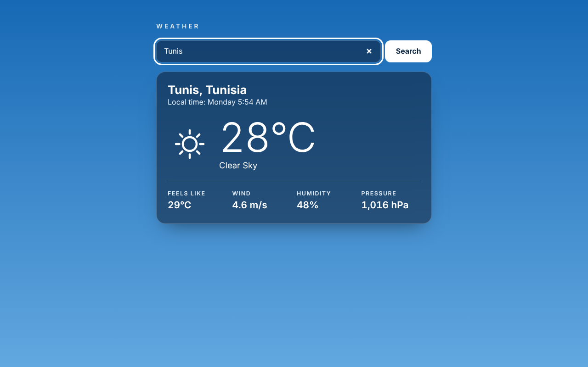
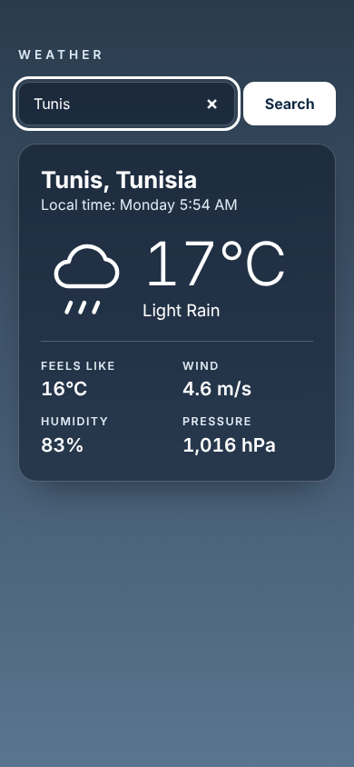

# Weather App

Look up the current weather for any city: temperature, conditions, local time, wind, humidity and pressure. Plain HTML, CSS and JavaScript, no framework, no build step. The page background follows the conditions and the time of day.

Live demo: https://weather-app-kohl-five-16.vercel.app

| Desktop | Mobile |
| --- | --- |
|  |  |

> The screenshots were taken with a hand-made demo response for the weather API (the API cannot be reached from the sandbox they were produced in). The numbers are not real weather data.

## You need a free API key

The app uses the OpenWeather "Current weather" API. Without a key it shows an "API key needed" message and nothing else.

1. Create a free account at https://openweathermap.org/api and copy your API key. New keys can take up to a couple of hours to activate.
2. Open `config.js` and set the constant:

   ```js
   const OPENWEATHER_API_KEY = "your-key-here";
   ```

3. Reload the page.

This is a static site, so a key placed in `config.js` is visible to every visitor. Use a free key you can rotate and do not commit a paid or private one.

**Security note:** the original version of this project had three API keys hard-coded in `main.js` (OpenWeatherMap `appid`, TimeZoneDB `key` and Pixabay `key`). They remain in the git history, so treat them as public and rotate them. The app now only needs the OpenWeather key: the local time is calculated from the UTC offset OpenWeather returns, and the Pixabay video thumbnail background was replaced by a CSS sky.

## Features

- Search by city (add a country code to disambiguate, for example `Cairo,EG`). Enter submits; the last successful city is remembered and reloaded.
- Clear states for empty input, loading, city not found, rejected key, rate limit, network failure and a 10 second timeout. A new search cancels the previous request.
- Local time of the searched city, country name from `Intl.DisplayNames`, and weather icons drawn as inline SVG (no image requests).
- API data is inserted as text, never as HTML.
- Sky themes: clear, clouds, rain, thunderstorm, snow and mist, each with a day and night variant where it matters. Smooth background change, disabled when `prefers-reduced-motion` is set.
- Accessible: labelled search form, `role="alert"` for input errors, the result card is a polite live region with `aria-busy` while loading, visible focus rings, responsive from 320px up.

## Run it

```sh
python3 -m http.server 5251
# open http://localhost:5251
```

It deploys to Vercel as a static site with no build step.

## Verification

Checked in headless Chromium with Playwright, with the OpenWeather endpoint answered by hand-made JSON through network routes (and the key injected through a route, not committed): the missing-key state, empty input, a successful lookup, rain and thunderstorm skies, a name containing HTML (rendered as text), 404, 401, 429, network failure, timeout, and restoring the last city after reload. There were no console errors and no horizontal overflow at 1280px and 390px widths.

**Not verified:** calls to the real OpenWeather API, since the sandbox cannot reach it. The response fields used (`main`, `weather`, `wind`, `sys.country`, `timezone`, `name`) follow OpenWeather's documentation.

## Known limitations

- Metric units only (°C, m/s, hPa); no unit switch, forecast or geolocation.
- Needs an OpenWeather key before it does anything (see above).
- The sky is a visual theme, not a map or satellite image.

## Notes

UI and code quality improvements were made with AI assistance (Claude, Anthropic), reviewed and verified by building and running the app.
